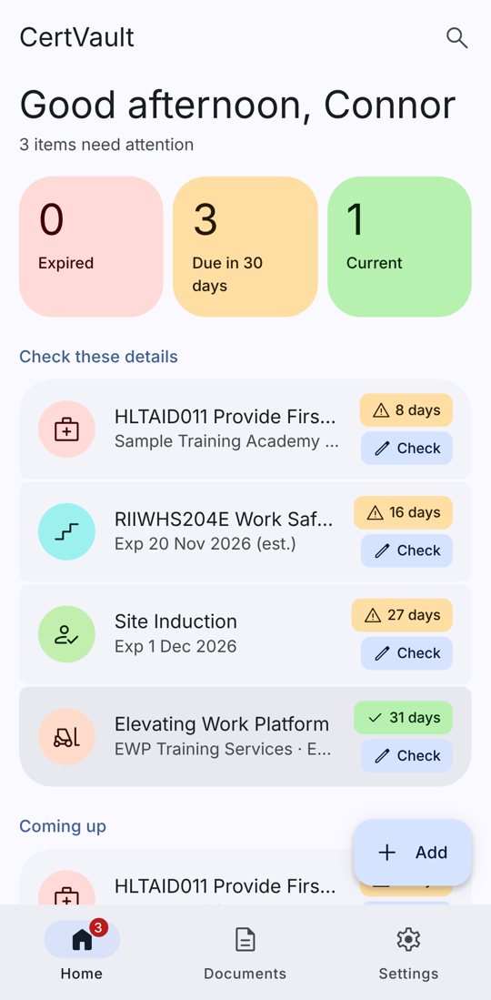
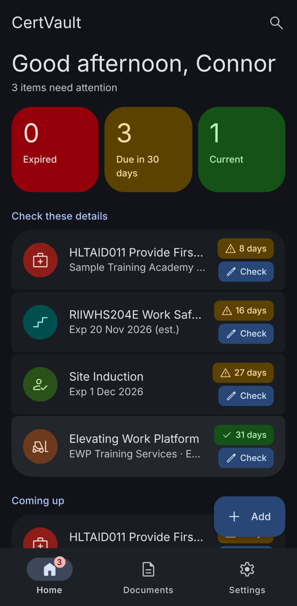
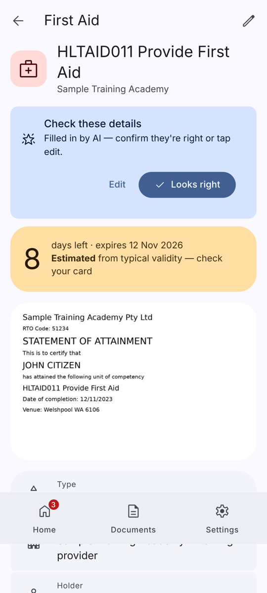
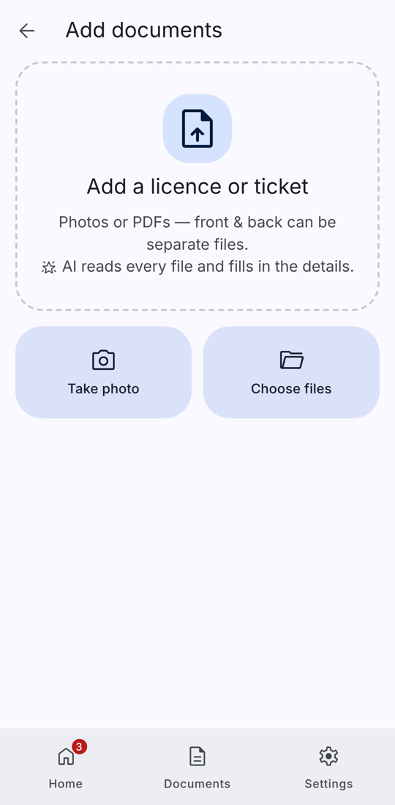

# CertVault

Self-hosted vault for your **licences, tickets, certificates and site inductions**. It runs on your NAS.
Upload a photo or PDF. **AI reads the file and fills in the details**: type, who issued it, holder, number, completion date, expiry date and location. You get **phone notifications 30, 14 and 7 days before expiry and on the day** (you can change these).

<p>
   
</p>

## Features

- **Upload from your phone.** Take a photo with the camera or pick PDFs/images (JPG, PNG, WEBP, HEIC).
- **Import a whole folder.** Tap **Import folder** (or drag a folder onto the page on a PC). Every PDF, photo and register spreadsheet inside, including sub-folders, is uploaded in batches. Duplicates are skipped and non-cert files ignored.
- **Registers.** Rigging gear, height safety gear, test & tag, plant/equipment and other registers, as PDF, photo or **Excel/CSV**. The last inspection date and the earliest *next inspection due* date are pulled out, and reminders say "inspection due" instead of "expires".
- **Renewals / previous versions.** Upload a renewed ticket and it's grouped with the older copies of the same cert. Only the newest sends reminders. The ⋮ menu on a document shows **Previous / expired versions**, and you can mark one *Not a renewal — keep separate*.
- **Master list.** One text-only list of every document with every field. It's on the *Master list* tab (filter, print, tap a row to open it) and downloads as Excel or CSV. An always-current copy is also saved on the NAS at `/mnt/CME_Nas/certvault/exports/<you> - CertVault Master List.xlsx` (and `.csv`).
- **AI autofill.** Claude (Anthropic API) or your own **Ollama** vision model looks at every file. OCR text is also sent to help it.
  - Without AI it still works: Tesseract OCR and Australian/WA-specific rules pick out dates, unit codes, RTOs and issuers.
  - **Re-read all documents** runs every stored file through the AI again and fills in any blank fields.
- **Auto-categorised.** Types it recognises: Driver's licence, HRWL, rigging/dogging, white card, first aid, CPR, heights, rescue (tower/pole/LV), confined space, gas test, EWP, RF/EME, traffic, electrical/cabling, police clearance, WWC, MSIC/ASIC, site inductions and other training. Issuers are grouped as government (WA DoT, WorkSafe, …), training provider (RTO) or company/site.
- **Expiry estimates.** If a card has no printed expiry, CertVault estimates one from typical validity (first aid 3 yrs, CPR 1 yr, heights 2 yrs …) and flags it as *estimated*.
- **Reminders.** Default schedule is 30/14/7/0 days. You can override it per document (e.g. 60,30,7,0). Weekly nags after expiry are optional. If the NAS was off on a reminder day, it catches up without spamming you.
- **Notification channels:**
  - [ntfy](https://ntfy.sh) push to Android
  - Email (SMTP, e.g. a Gmail app password)
  - Home Assistant webhook, which can forward to the HA companion app
- **Android look and feel.** Material You (Material 3) design with Material Symbols Rounded icons, a bottom navigation bar, a FAB, and light/dark themes with 5 accent colours. You can install it to the home screen as a PWA.
- **Security:**
  - argon2id password hashing, plus optional 2-step login (TOTP: Google Authenticator, Aegis…)
  - HttpOnly + SameSite=Strict session cookies and CSRF tokens
  - Brute-force lockout: 5 failed attempts per user, or 20 per IP, locks for 15 minutes
  - Strict Content-Security-Policy and other security headers
  - Uploads are checked by file signature, re-encoded to strip EXIF/GPS, stored under random names and only served to their owner
  - The container runs as non-root (UID 568) with a read-only filesystem, no capabilities and no-new-privileges
- **Multi-user.** You can add family or crew members, and each person only sees their own documents.

## Install on TrueNAS SCALE (25.x)

**Quickest:** open **System → Shell** in TrueNAS and paste:
```bash
curl -fsSL https://raw.githubusercontent.com/Connor-Moyle/certvault/main/install-truenas.sh | sudo bash
```
It creates the `CME_Nas/certvault` dataset, installs the app on port 30090 and prints your setup code.

**Manual:**

1. **Create a dataset** for the data, e.g. `CME_Nas/certvault`. Give the `apps` user (568) full control.
   From a shell:
   ```bash
   sudo mkdir -p /mnt/CME_Nas/certvault && sudo chown 568:568 /mnt/CME_Nas/certvault
   ```
2. **Apps → Discover Apps → ⋮ (top right) → Install via YAML.** Name it `certvault` and paste [`docker-compose.yml`](docker-compose.yml).
3. Open the app's **Logs** and copy the **setup code**. It's also saved in `/mnt/CME_Nas/certvault/SETUP_CODE.txt`.
4. Browse to **http://192.168.0.50:30090**, enter the setup code and create your account.

> **Image pull denied?** GitHub sometimes publishes new packages as private. Go to GitHub → your profile → *Packages* → `certvault` → *Package settings* → **Change visibility → Public**.
> Or build on the NAS instead:
> ```bash
> git clone https://github.com/Connor-Moyle/certvault.git && cd certvault
> sudo docker compose -f docker-compose.build.yml up -d --build
> ```

### Updating
TrueNAS: **Apps → certvault → Update** (or *Edit → Save* to re-pull `:latest`). Your data in the dataset is kept.

## Set up AI autofill

**Settings → AI document reading** (admin only):

| Option | What you need | Notes |
|---|---|---|
| **Claude** | API key from [console.anthropic.com](https://console.anthropic.com) | Most accurate; reads PDFs natively. About a cent or two per document. Default model `claude-sonnet-5-5`. |
| **Ollama (local)** | Ollama reachable from the NAS + a **vision** model | Free and private. Run it on the desktop GPU for speed: `ollama pull qwen2.5vl:7b`. Set Ollama to listen on the LAN (`OLLAMA_HOST=0.0.0.0`) and use `http://<desktop-ip>:11434`. The NAS (8 GB RAM, no GPU) will be very slow with vision models. |
| **Off** | – | OCR + rules only. |

Press **Test**, then **Re-read all documents** to run the AI over everything already uploaded.

## Notifications on Android (ntfy)

1. Install **ntfy** from the Play Store.
2. In CertVault go to **Settings → Notifications → Make a private topic → Save**.
3. In the ntfy app tap **+**, subscribe to the same topic name (e.g. `certvault-k3j9…`), then press **Send test** in CertVault.

The topic name works like a password, so keep it random. If you'd rather self-host ntfy on the NAS, put your own server URL in instead.

Reminders go out once a day at the time you set (default 8 am Perth). **Check now** runs the check straight away.

## Access away from home

Don't port-forward it. Tailscale is already on the NAS, so open `http://<nas-tailscale-name>:30090` from your phone on Tailscale.
For HTTPS (needed for the "Install app" prompt and offline shell), use `tailscale serve --bg 30090` on the NAS and set `CV_COOKIE_SECURE: "true"`.

## Backup

Everything is in the dataset: `certvault.db` (SQLite) plus the `files/` and `thumbs/` folders. Include that dataset in your snapshot/replication tasks.
Tip: enable **dataset encryption** on `certvault` in TrueNAS if you want encryption at rest.

## Configuration (environment variables)

| Variable | Default | |
|---|---|---|
| `TZ` | `Australia/Perth` | Timezone for reminder days |
| `CV_DATA_DIR` | `/data` | Where DB and files live |
| `CV_MAX_UPLOAD_MB` | `25` | Max size per file |
| `CV_SESSION_DAYS` | `30` | Idle days before re-login |
| `CV_COOKIE_SECURE` | `auto` | `true` when served only over HTTPS |

To add your own categories, edit `app/categories.py`. The UI and the AI prompt pick them up automatically.

## Development

```bash
pip install -r requirements.txt pytest
sudo apt install tesseract-ocr poppler-utils   # OCR + PDF tools
CV_DATA_DIR=./data uvicorn app.main:app --reload --port 8080
pytest -q tests
```

Stack: FastAPI · SQLite · Tesseract · Poppler · vanilla JS (no build step) · Material Symbols (Apache-2.0).
Icon sprite: `npm i @material-symbols/svg-400 && python tools/build_icons.py node_modules/@material-symbols/svg-400/rounded`.

## License
MIT
